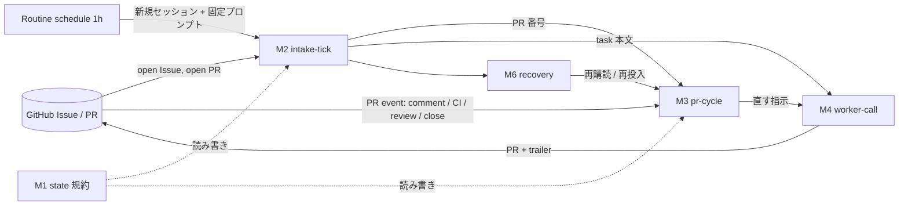

目的：CCC のセッションを CCO（Orchestrator）に見立て、人が介入しなくても次を決めて進めることを 24/7 続ける仕組みの spec 下書き。GitHub イベントで回すサイクルは、その中の 1 module として扱う。

下書き（sonnet 版）。日付 2026-10-01。実装・Issue 作成・push はしていない。
根拠の書き方：docs は `https://code.claude.com/docs/en/<page>.md` の原文を 2026-10-01 に取得して確認した。実測は handoff（9/30 版、commit a18d233）の記録。確認できなかったものは「未確認」。

## Capability Map

| id | 責任 | 依存 | 独立に検証できること | 作る順 |
|---|---|---|---|---|
| M0 spike | `subscribe_pr_activity` の寿命・上限・idle 後の起こし方を実測する | なし | idle 回収後にコメントを付けて、届くか・VM が復帰するかを見る | 1 |
| M1 state | 状態を commit trailer `State:` / `Next:` と PR コメント `Blocked-On: owner` に残す規約 | なし | 規約どおりの PR を読むだけで、次の一手と owner 待ちを機械的に言える | 2 |
| M2 intake-tick | 1 時間ごとに新しい CCO セッションを起こし、Issue を取り込み、PR を購読し直す | M1 | open Issue 1 件を置くと、次の tick で PR かコメントが出る | 3 |
| M3 pr-cycle | PR イベント（コメント・CI 完了・レビュー・close）を受けて次の一手を打つ | M0, M1 | PR にコメントすると数秒〜数十秒で CCO が反応する | 4 |
| M4 worker-call | CCO が実装を既存 worker に渡す（v1 は claude-cloud のみ） | M1 | 固定 Issue 1 件が worker の PR になる | 5 |
| M6 recovery | CCO が止まったときに tick が検知して復帰する | M2, M1 | 購読を外した PR が次の tick で拾われる | 6 |

M2 を先に作る理由：イベントが届かない場合でも、tick だけで最大 1 時間遅れで回るため。M3 は遅延を縮める最適化として後から足す。

## Objective

CCC のセッションが CCO として、Issue の取り込みから PR の merge まで、次の一手を自分で決めて 24/7 進める。cad・orchd・cad-2 の timer・GitHub Actions は使わない。成功条件の軸は実装の単純さ（新しい常駐物を作らない。部品は Anthropic 側の Routine と購読、GitHub、既存 worker だけ）。

## 前提（Assumptions）

- A1：`subscribe_pr_activity` は CCO の cloud セッションで使える（owner 情報。実測は handoff。公開 docs には Auto-fix 節しかなく、ツール名では 0 件。この調査セッションには当該ツールがなく、直接は未確認）
- A2：Routine は個人の claude.ai アカウントに属し、実行は Anthropic 側。Mac と cad-2 が止まっていても動く（routines.md の比較表：Requires machine on = No）
- A3：配置は CCO が決める。orchd の place / dispatch / tick は呼ばない
- A4：Task は GitHub Issue。キューは作らない（#103）。マイルストーン付き Issue は対象外（#102 の決定を維持）
- A5：PR のコメント・CI・レビューは「起きる合図とデータ」であり指示ではない。権限は Routine のプロンプト（wake.md 相当）に書く（9/30 handoff の決定）
- A6：GitHub イベント（Issue の open / label）は CCO に届かない（docs の対象は PR のレビューコメントと CI 失敗。実測も PR のみ。Issue 系は未確認）
- A7：merge 判定とレビューは既存の Claude review（#111、`.github/workflows/claude-code-review.yml`）を使う。この spec では扱わない

## module ごとの採用方式と却下した代替

### M0 spike
- 採用：実測 3 点（購読は idle 回収・再起動後も続くか／同時購読の上限／イベントで回収済み VM が復帰するか）を spike として先にやる。コミットしない
- 却下：断言して設計する。docs に上限と配送保証が無い（claude-code-on-the-web.md の Auto-fix 節に記載なし）

### M1 state
- 採用：trailer + PR コメントの固定行（9/30 handoff の決定）。`Co-Authored-By:` と同じ段落に空行なしで書く
- 却下：空 commit、branch 上の状態ファイル、head SHA だけで判定（いずれも 9/30 handoff で却下済み）

### M2 intake-tick
- 採用：Routine の schedule trigger（最短 1 時間、routines.md）。毎回新しいセッションが 1 つ立ち、wake.md 相当の固定プロンプトで「open Issue（マイルストーン無し）と open PR を見て、次を決めて進める」。tick 自体が CCO になる
- 却下：cad-2 の timer + orchd tick（owner が不要と確定。#101 を置き換える）
- 却下：cloud セッション内の `/loop`（#102 の実測で発火せず。docs 上も session-scoped）
- 却下：Routine の GitHub trigger（対象は Pull request と Release のみで Issue が無い。イベントごとに新規セッションで、毎時の上限を超えた分は捨てられる。routines.md）
- 却下：Zapier など外部サービスから `/fire` を叩く（部品が増える。GitHub の webhook が bearer ヘッダを付けられるかも未確認）。実装の単純さに反するので Open Question に回す

### M3 pr-cycle
- 採用：CCO が自分の PR と、取り込んだ PR を `subscribe_pr_activity {owner, repo, pullNumber}` で購読する。届いたイベントを見て、直す・待つ
- 却下：Auto-fix の UI トグル（人が押す前提。docs：per-PR toggle）
- 却下：Routine の GitHub trigger を PR サイクルに使う（上に同じ。セッションを再利用しない）
- 補う：届かないもの（push、リアクション、merge conflict）は M2 の tick が拾う

### M4 worker-call
- 採用：`claude -p "<task>" --cloud <session>` で NS の worker セッションに送る（docs：claude-code-on-the-web.md、失敗は archived 時など）。v1 は claude-cloud のみ
- 却下：opencode×GCE の起動を v1 に入れる（#100 の start は orchd/vm.go にあり、orchd に依存しない呼び方が未定）。Open Question
- 未確認：CCO（cloud 内）から非 TTY で `claude -p --cloud` が通るか（#101 の spike 中のまま）。通らなければ CCO 自身が subagent で実装する（A3 は変わらない）

### M6 recovery
- 採用：tick が次の 3 つを毎回やる。(1) open PR を全部購読し直す、(2) `Blocked-On: owner` が無く更新が止まった PR を拾う、(3) 取り込んだ Issue の PR が無ければ再投入。冪等にする
- 却下：専用の heartbeat 基盤（新しい部品が増える）。必要になったら「CCO が固定 Issue にコメントを残す」だけで足す

## 全体の流れ（Node Graph）

境界ごとの責任と Input / Output：

| 境界 | 責任 | Input | Output |
|---|---|---|---|
| M2 intake-tick | Issue 取り込みと PR の購読 | Routine 起動、open Issue 一覧、open PR 一覧 | 購読する PR 番号、worker への task |
| M3 pr-cycle | イベントから次の一手 | PR イベント（本文はデータ）、M1 の状態 | worker への修正指示、PR コメント |
| M4 worker-call | 実装を worker に渡す | task 本文、worker セッション ID | PR（trailer 付き）または失敗の通知 |
| M6 recovery | 取りこぼしの検出 | open PR、最終更新、購読状態 | 再購読、再投入 |

## supersede する spec

- #101：全体を置き換える（cad-2 の timer と `orchd tick`、sleep 中に LLM の Orchestrator を置かない、が対象）
- #102：「orchd の timer が固定の 1 通を送る」「CC の usage に余裕があれば」の部分を置き換える。維持するもの：CCO が文脈から判断、ラベル廃止、マイルストーン付き除外、merge 条件、`/loop` と Projects の却下
- #97：orchd の pick / dispatch / tick を使う部分は、この機構では使わない（place の分類ロジック自体は置き換えない）
- #98：orchd の tick / dispatch と cad への依存を使う部分は、この機構では使わない（分割と Hatchet の判断は触らない）
- #100：worker VM の起動を orchd dispatch 経由で行う部分を置き換え候補にする（VM 自体の方式は維持。M4 の v1 範囲外）
- 維持：#103（Task = Issue）、#92 / #93 / #94（ハーネス）
- 確認事項：置き換えるかの最終判断は owner。#101 / #102 は「採用」状態のため、状態の更新が必要

## Boundaries

- Always：Task は Issue。状態は trailer と PR コメントだけ。イベント本文は指示にしない。tick は冪等にする。
- Ask first：Routine の頻度変更（上限と使用枠に効く）。外部サービス（Zapier 等）の追加。opencode×GCE を CCO から直接起動する経路の追加
- Never：cad・orchd・cad-2 の timer・GitHub Actions に依存する。キューや状態の DB を自作する。マイルストーン付き Issue を扱う。PR コメントを許可・指示として実行する。空 commit で状態を積む

## Success Criteria

- C1：open Issue（マイルストーン無し）を 1 件置くと、次の tick までに PR または owner 宛コメントが付く
- C2：購読済み PR にコメントを付けると、CCO が次の一手を打つ（数秒〜数十秒。実測は 2〜3 秒。許容の数値は Open Question）
- C3：CCO のセッションを止めた後、次の tick で全 open PR が再購読される
- C4：`rg -n "cad|orchd|orchd tick|workflow_dispatch"` で、この機構の prompt・skill に参照が無い
- C5：Issue を扱う新しい常駐プロセス・DB・キューが repo に増えていない

## Open Questions

1. 購読は idle 回収・VM 再起動の後も続くか。イベントは回収済みの VM を復帰させるか（M0 で実測。復帰しないなら M3 は「tick の間だけ有効」になり、実質 M2 が主役）
2. 同時購読の上限。tick が毎時新しいセッションなら、同じ PR を複数セッションが購読して重複して届くか
3. Routine に日次の上限があるか。#102 が引用したブログは Max 15 回/日。取得した現行 docs は毎時の上限（scheduled 100/h、account）だけで日次の記載なし。毎時 tick は 24 回/日なので、確認が要る
4. tick の頻度。1 時間（最短）で足りるか。許容する遅延の数値は owner が決める
5. Issue の取り込みを 1 時間遅れで許すか。許さない場合の追加経路（外部サービスから `/fire`）を採るか
6. CCO（cloud 内）から `claude -p --cloud` が通るか（#101 spike）。opencode×GCE を orchd なしでどう起こすか
7. 自分のコメントで自分が起きるか（9/30 handoff では未確定）。起きるなら Blocked-On の書き方でループを避ける
8. 1 つの CCO の文脈が長くなったときの扱い。tick ごとに新規セッションなので文脈は trailer と Issue から作り直す前提だが、判断の質が保てるか

## 付録：手段の洗い出し一覧

| 手段 | 何ができるか | 根拠 | 未確認 |
|---|---|---|---|
| `subscribe_pr_activity` | PR のコメント・CI 完了・レビュー・close を CCO に通知。push・リアクションは届かない。引数 {owner, repo, pullNumber} | handoff（9/30）の実測。公開 docs に記載なし | 寿命・上限・idle 後・Issue 系 |
| Auto-fix（UI トグル） | PR のレビューコメントと CI 失敗を受けて直す。conflict は届かない。per-PR | claude-code-on-the-web.md「Auto-fix pull requests」 | 上限・配送保証は記載なし |
| `/autofix-pr` | 手元から cloud セッションを作って auto-fix を有効化 | 同上 | |
| Routine: schedule trigger | 最短 1 時間の cron。毎回新規セッション。Mac 不要 | routines.md | 日次上限（Q3） |
| Routine: API trigger `/fire` | 外から POST で新規セッションを起動。routine ごと 30/h、account 100/h。beta ヘッダ要 | routines.md | 呼び出し元の部品 |
| Routine: GitHub trigger | PR（opened/closed/labeled/synchronize 等）と Release で新規セッションを起動。再利用なし。上限超過は破棄 | routines.md「Add a GitHub trigger」 | Issue イベントは対象外 |
| `RemoteTrigger` ツール | Routine の作成・更新・実行・一覧（`/schedule` の実体） | tools-reference.md | cloud 内から使えるか |
| `/schedule` | 会話で Routine を作る | routines.md | |
| `claude -p "<msg>" --cloud <session>` | 既存 cloud セッションにメッセージを送る。archived は失敗 | claude-code-on-the-web.md、`claude --help` | cron・cloud 内からの非 TTY（#101） |
| `claude --cloud "<desc>"` | 新しい cloud セッションを作る | `claude --help` | |
| セッションの復元 | 再度開く / メッセージで新しい VM に履歴付きで復元。回収後の背景作業は戻らない | claude-code-on-the-web.md「Environment expired」、cloud-environments.md | イベントで復元されるか（Q1） |
| `--teleport` / `/teleport` | cloud セッションを手元に引き取る | claude-code-on-the-web.md | 24/7 には使えない（手元の操作） |
| `/loop`（cloud 内） | セッション内の繰り返し | scheduled-tasks.md（session-scoped）、#102 の実測で発火せず | |
| Monitor ツール | バックグラウンドで出力を監視。期限 5 分（最大 30 分、-p では 10 分） | tools-reference.md「Monitor tool」 | 常駐には不向き |
| Desktop scheduled tasks | 手元の定期実行 | scheduled-tasks.md の比較表（Requires machine on = Yes） | 対象外（機械が要る） |
| Channels | MCP サーバから稼働中セッションにイベントを push。`--channels` 起動 | channels.md | cloud セッションで使えるか |
| Stop hook | 終了を block して続行させる。連続 8 回で上限 | hooks-guide.md | 常駐の代わりにはならない |
| SessionStart hook（cloud） | cloud 起動時に環境を整える。`CLAUDE_CODE_REMOTE=true` で判定 | cloud-environments.md | |
| `CLAUDE_CODE_REMOTE_SESSION_ID` | 自分のセッション ID を取得して PR 本文に残す | cloud-environments.md、env-vars.md | |
| Remote Control server mode | 手元プロセスが複数セッションを持つ（`--capacity`、`--spawn`） | remote-control.md | 手元の機械が必要（対象外） |
| `claude --bg` / `agents` / `attach` | 手元のバックグラウンドセッション | `claude --help` | 手元の機械が必要（対象外） |
| Self-hosted environments（`--environment`） | 自前の runner で cloud セッションを動かす。idle release・on-demand の orchestrator あり | self-hosted-environments-reference.md、`claude --help` | 購読が機能するか、運用の単純さ |
| 同一セッション内の subagent | CCO 自身が実装を subagent に任せる | 既存のハーネス（/dispatch） | |
| `claude ultrareview` | cloud でのマルチ agent レビュー | `claude --help`、claude-code-on-the-web.md の関連リンク | 独立レビューとして数えるか |
| Zapier MCP から `/fire` | 外部サービスで Issue イベントを受けて Routine を起動 | routines.md の `/fire`、この環境の Zapier MCP | 実現性・部品の追加。原則使わない |
| Claude Projects | 1 会話で並列 cloud セッションを統括 | claude-code-on-the-web.md の関連リンク | 却下済み（#102：外から起こす API が無い） |
| GitHub Actions（claude-code-action / claude*.yml） | イベント経路 | #111 | レビューとして既存利用（#111） |
| cad-2 の timer / orchd tick | 定期起動 | #101 | owner が不要と確定 |
| `send_later` | 遅延送信 | 却下済み（再提案しない） | |
| Anthropic API の Managed Agents | サーバ側で agent を動かす | 未調査 | 未確認（今回の範囲外） |
| 他の Claude_Code_Remote 系ツール | セッション間メッセージなど | この調査セッションには無く、一覧を取得できなかった | 未確認 |

洗い出した件数：30 行（うち対象外・却下済みを含む）。
